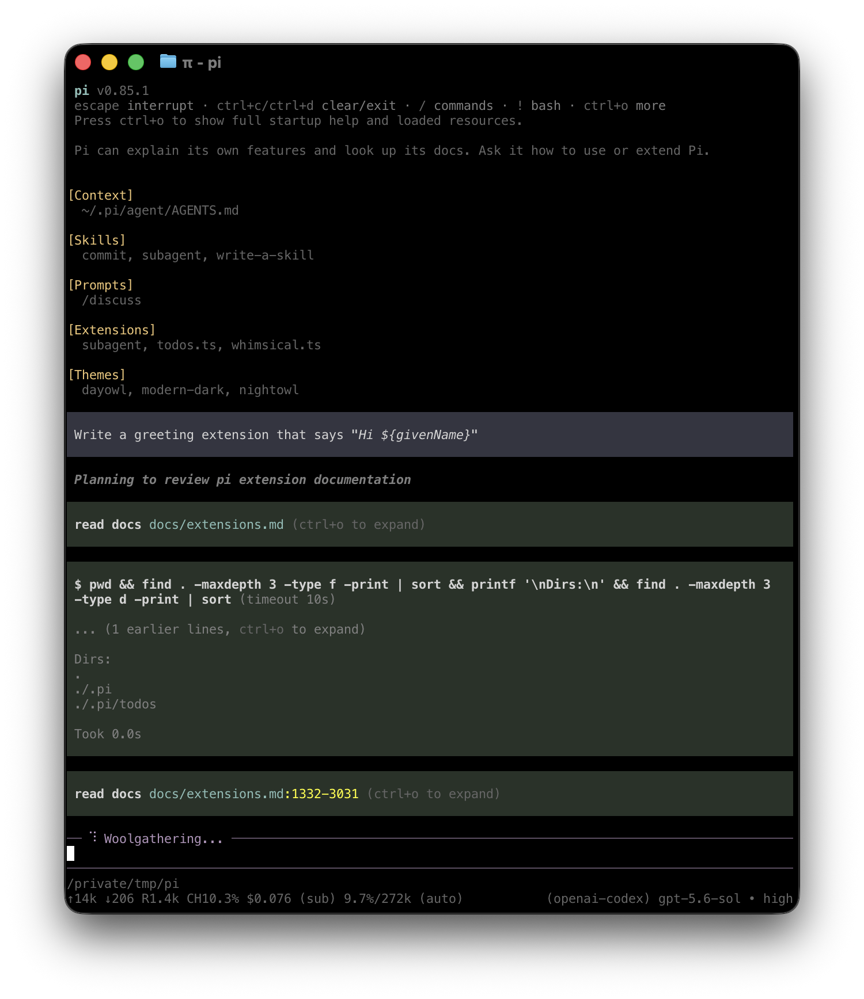

# Quickstart

msa runs in your terminal and works with files on your machine. To use it, you need access to a model through a supported provider. This can be a subscription, an API key, or a local model.

For native Windows setup, read [Windows Setup](windows.md). For Android, read [Termux Setup](termux.md).

## 1. Install msa

msa runs from a checkout of this repository and requires Node.js 22.19 or newer:

```bash
git clone https://github.com/masseater/msa
cd msa
vp install
```

`./scripts/msa-dev.sh` runs msa from these sources and can be called from any directory. Put it behind a shell alias or a small script on your `PATH` if you want a plain `msa` command.

Verify the installation:

```bash
./scripts/msa-dev.sh --version
```

## 2. Start msa

Change to the folder you want msa to work with, then start it. When running from source, use `./scripts/msa-dev.sh` in place of `msa`:

```bash
cd /path/to/folder
/path/to/msa/scripts/msa-dev.sh
```

The working folder helps msa discover relevant files, instructions, and configuration. msa also uses it to group saved sessions.

<p align="center"></p>

The interface shows your conversation, an editor for prompts and commands, and a footer with the current folder, model, and session status. See [Use msa in the terminal](usage.md) to learn how to add files, run commands, direct ongoing work, and manage results.

## 3. Choose a model

A **model** generates msa's responses. A **provider** is the service or account msa uses to access that model.

In msa, run:

```text
/login
```

Choose a provider, then follow the prompts to use a subscription or store an API key. Run `/model` afterward if you want to select a different available model.

See [Choose a model and provider](models.md) for supported providers, environment-variable authentication, local models, and custom endpoints.

## 4. Give msa a task

msa shows each file read, search, command, and edit it performs. It does not ask before every tool call.

Enter a task that matches your work, for example:

```text
Summarize @meeting-notes.md and save the action items to action-items.md.
```

```text
Explain how this repository is structured and how to run its checks.
```

```text
Compare @previous.csv with @current.csv and summarize the important changes.
```

Type `@` in the editor to search for a file instead of entering its full path. When msa finishes, review its response and any changed files. Use version control or backups for important work. For untrusted or unattended work, use a container or another sandbox. See [Security](security.md).

## Continue later

msa saves sessions automatically. Exit msa, then resume the most recent session for the same working folder with:

```bash
msa --continue
```

Use `/resume` to choose another saved session. See [Continue or branch a session](sessions.md) for session naming, branching, compaction, export, and sharing.

## Next steps

- [Use msa interactively](usage.md) to learn input, commands, shortcuts, and queued messages.
- [Add instructions](configuration.md#context-files) that msa should follow whenever it works in a folder.
- [Choose a model and provider](models.md).

### Choose how to customize msa

Start with the least powerful mechanism that meets your need:

| Need                                                | Start with                                    |
| --------------------------------------------------- | --------------------------------------------- |
| Give msa persistent instructions for a folder       | [`AGENTS.md`](configuration.md#context-files) |
| Reuse a prompt from the `/` menu                    | [Prompt template](prompt-templates.md)        |
| Add task-specific instructions and supporting files | [Skill](skills.md)                            |
| Add executable tools, commands, or event handlers   | [Extension](extensions.md)                    |
| Build a custom terminal component                   | [Terminal UI](tui.md)                         |
| Connect an unsupported model service                | [Custom provider](custom-provider.md)         |
| Install or distribute several resources             | [msa package](packages.md)                    |

## Uninstall msa

Delete the checkout. This does not remove configuration, credentials, sessions, or installed msa packages from `~/.msa/agent/`.
